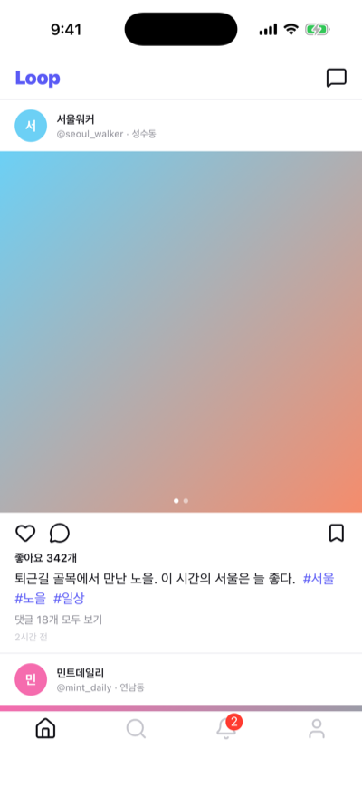
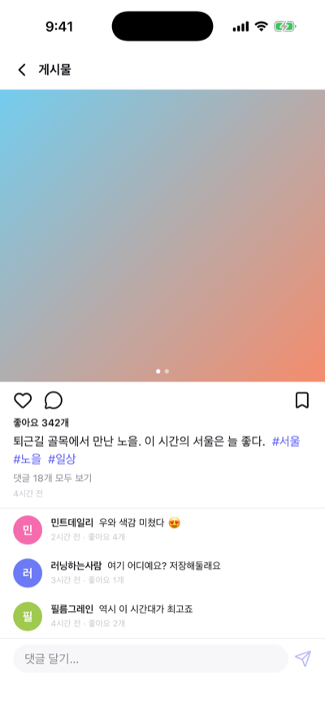
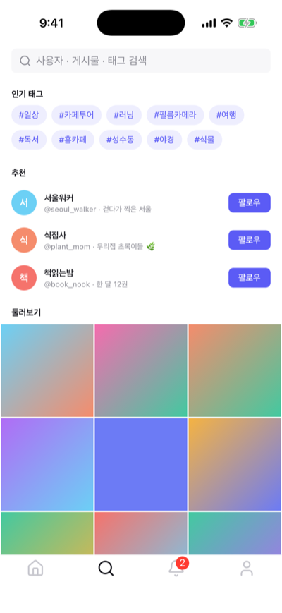
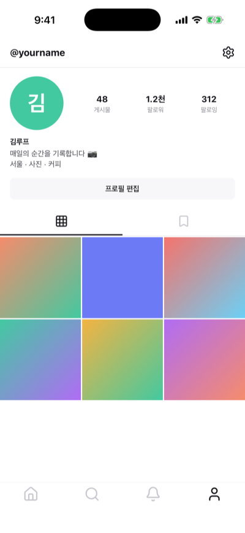
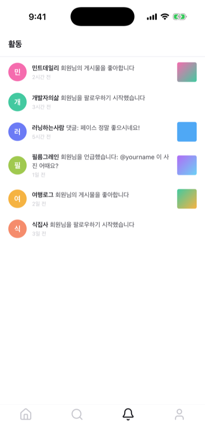
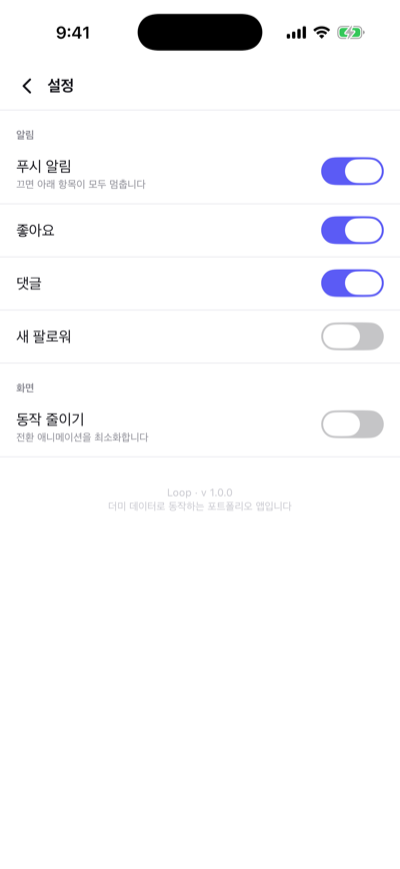
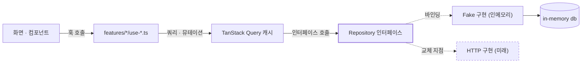
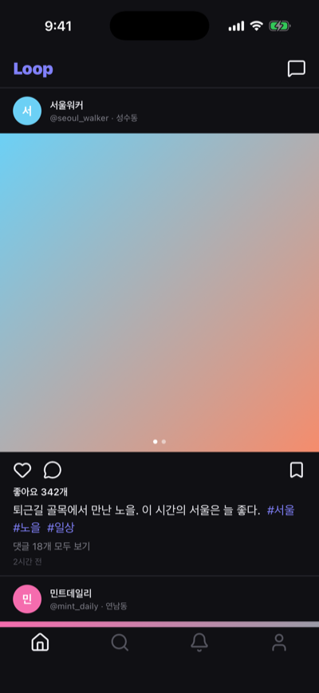

# Loop

React Native(Expo)로 만든 **SNS 앱 UI/UX 쇼케이스**.
백엔드 없이 **더미 데이터만으로** 피드·검색·프로필·활동·메시지·설정 전 화면이 iOS·Android·Web에서 동작합니다.

> 실제 서비스가 아니라 **아키텍처와 화면 구현을 보여주기 위한 포트폴리오**입니다.
> 같은 앱을 Kotlin/Jetpack Compose로 먼저 만들고, 이를 크로스플랫폼으로 다시 설계·이식했습니다.

> [!IMPORTANT]
> **이 저장소의 코드는 한 줄도 직접 타이핑하지 않았습니다.**
> 설계 방향과 기술 판단을 자연어 프롬프트로 지시하고, [Claude Code](https://claude.com/claude-code)가
> 전부 작성했습니다.
> <!-- stats-line:start -->
> 현재 소스 65개 파일 4,634줄, 테스트 33개.
> <!-- stats-line:end -->
>
> 어디까지가 사람의 몫이고 어디부터가 에이전트의 몫이었는지는
> → **[어떻게 만들어졌나 — 바이브 코딩 기록](#어떻게-만들어졌나--바이브-코딩-기록)**
> · 세션별 작업 내역은 **[docs/vibe-log.md](docs/vibe-log.md)**

<p align="center">
  
  
  
  
</p>
<p align="center">
  
  
  
  
</p>

<p align="center"><sub>iPhone 17 · iOS 26.5 시뮬레이터</sub></p>

---

## 목차

- [무엇을 보여주는 프로젝트인가](#무엇을-보여주는-프로젝트인가)
- [어떻게 만들어졌나 — 바이브 코딩 기록](#어떻게-만들어졌나--바이브-코딩-기록)
- [기능 명세](#기능-명세)
- [기술 스택](#기술-스택)
- [아키텍처](#아키텍처)
- [상태 관리 전략](#상태-관리-전략)
- [데이터 계층 — 교체 가능한 설계](#데이터-계층--교체-가능한-설계)
- [디자인 시스템](#디자인-시스템)
- [품질 관리](#품질-관리)
- [실행 방법](#실행-방법)
- [프로젝트 구조](#프로젝트-구조)
- [Kotlin 원본과의 관계](#kotlin-원본과의-관계)
- [개발 진행 단계](#개발-진행-단계)
- [범위와 한계](#범위와-한계)

---

## 무엇을 보여주는 프로젝트인가

SNS는 기능 자체보다 **상태가 화면을 넘나들며 어긋나지 않게 유지하는 일**이 어렵습니다.
좋아요 하나를 눌러도 그 게시물은 피드·상세·프로필 그리드·북마크 목록에 동시에 떠 있을 수 있습니다.

이 프로젝트가 증명하려는 것은 다음 네 가지입니다.

| | 무엇을 | 어떻게 |
|---|---|---|
| 1 | **상태 일관성** | 한 번의 토글이 그 데이터가 들어 있는 모든 캐시에 동시 반영. 탭을 옮겨도 되돌아가지 않음 |
| 2 | **교체 가능한 데이터 계층** | 화면은 인터페이스만 의존. 실제 API 전환 시 **바인딩 한 줄**만 변경 |
| 3 | **디자인 시스템** | 색·치수를 토큰 단일 출처로 관리. 라이트/다크 2벌을 테스트로 동기화 강제 |
| 4 | **체감 성능** | 낙관적 업데이트로 네트워크 왕복을 기다리지 않는 UI |

---

## 어떻게 만들어졌나 — 바이브 코딩 기록

이 프로젝트에는 목적이 하나 더 있습니다.
**"프롬프트만으로 어느 수준의 결과물까지 나오는가"** 를 실제 산출물로 남기는 것입니다.

코드·테스트·문서·커밋 메시지까지 전부 Claude Code가 작성했습니다.
IDE에서 파일을 열어 손으로 고친 적은 없습니다.

### 역할 분담

바이브 코딩이라고 해서 "알아서 만들어줘" 한 줄로 끝난 것은 아닙니다.
사람이 한 일은 **코드를 쓰는 일이 아니라 판단하는 일**이었습니다.

| 사람(프롬프트) | 에이전트(Claude Code) |
|---|---|
| 무엇을 만들지 — "Kotlin 앱을 RN으로 전환" | 기존 앱 분석, 이식 범위 산정 |
| 제약 — "최신 트렌드", "포트폴리오용", "더미 데이터만" | npm 레지스트리 조회로 실제 최신 버전 확인 후 스택 확정 |
| 품질 기준 — "개발 정의서로 쓸 README" | 아키텍처 설계, 구현, 테스트, 문서 작성 |
| 환경 결정 — "iOS 시뮬레이터로 테스트" | 시뮬레이터 구동·조작·스크린샷 캡처 |
| 승인과 반려 — 범위 축소, 작업 중단, 방향 수정 | 수정 반영, 자기 주장 재검증 |

### 실제 작업 흐름

```
1. 기존 Kotlin/Compose 앱 분석          → feature 모듈·모델·더미 데이터 인벤토리
2. 스택 선정                            → 레지스트리에서 최신 버전 조회 후 결정
3. 스캐폴드 → 디자인 시스템 → 데이터 → 화면  → 레이어 순으로 구현
4. 검증                                 → tsc · Biome · Jest · iOS 시뮬레이터 실기 확인
5. 문서화                               → README 작성 후 주장이 참인지 재검증
6. 커밋 정리                            → 레이어 단위 5개로 재구성
```

### 에이전트가 스스로 잡아낸 것들

지시받지 않았지만 작업 중 발견해 고친 사항입니다. 바이브 코딩의 품질은
**"시키는 대로 하는가"보다 "틀린 것을 알아채는가"** 에서 갈립니다.

| 발견 | 조치 |
|---|---|
| 페이지 인디케이터가 배열 인덱스를 `key`로 써서 린트 경고 | 경고를 억제하는 대신 **미디어 id 목록을 받도록 API 변경** — 호출부도 이미 가진 값을 그대로 넘김 |
| README가 `expo-image`를 스택으로 소개했으나 실제 미사용 | "도입 시 사용 예정"으로 정정 |
| LICENSE 저작권자가 Expo(650 Industries) 그대로 | 본인 명의 MIT로 교체 |
| `.vscode` 설정이 ESLint 기준이라 Biome 스택과 불일치 | Biome 액션으로 교체 |
| 활동 화면은 진입 즉시 읽음 처리되어 "미읽음 표시"를 볼 수 없음 | 문서 서술을 실제 동작에 맞게 수정 |
| 디자인 토큰이 CSS와 TS 두 곳에 복제됨 | 복제를 없애는 대신 **일치를 강제하는 테스트** 추가 |

세션별 전체 내역은 **[docs/vibe-log.md](docs/vibe-log.md)** 에 쌓입니다.

### 생성과 반복은 다른 문제다

이 저장소는 두 단계를 모두 기록합니다.

| 단계 | 성격 | 어디서 확인 |
|---|---|---|
| **초기 생성** | 빈 저장소 → 전 화면 동작. 한 세션 | [세션 1](docs/vibe-log.md) |
| **이후 반복** | 지시에 따른 세부 수정 — **기존 구조를 깨지 않으면서** | [세션 2~](docs/vibe-log.md) |

"한 번에 뽑아낼 수 있나"보다 **"계속 고쳐 나갈 수 있나"** 가 실무에서 더 중요한 질문이라고 봅니다.
전자는 데모로 증명되지만, 후자는 기록이 쌓여야 증명됩니다.

### 산출물

<!-- stats:start -->
| | |
|---|---|
| 소스 | **65개 파일 · 4,634줄** |
| 레이어별 | app 1,686줄 · features 1,145줄 · entities 89줄 · data 1,180줄 · shared 478줄 |
| 테스트 | **33개** (4개 파일 · 337줄) |
<!-- stats:end -->

<sub>위 표는 `npm run stats` 가 소스에서 생성합니다. 손으로 적지 않으며, 낡으면 테스트가 실패합니다.</sub>

검증 수단은 매 세션 동일합니다 — `tsc --noEmit` · Biome · Jest · iOS 시뮬레이터 실기 확인.

### 솔직한 한계

- **사람의 판단을 대체하지는 않았습니다.** 범위를 줄이거나 방향을 바꾼 결정은 전부 프롬프트에서 나왔고,
  에이전트가 제안한 것 중 반려된 것도 있습니다.
- **검증 없이는 성립하지 않습니다.** 타입체크·린트·테스트·실기 확인이 매 단계에 걸려 있었기 때문에
  "그럴듯한데 틀린 코드"가 걸러졌습니다. 이 장치가 없으면 결과물의 신뢰도는 전혀 다릅니다.
- **잘 아는 도메인이라 가능했습니다.** 같은 앱을 Compose로 먼저 만들어 둔 상태였기에
  무엇이 맞고 틀린지 판단할 수 있었습니다. 모르는 영역이었다면 검수 자체가 불가능했을 것입니다.

---

## 기능 명세

### 화면

| 화면 | 경로 | 내용 |
|---|---|---|
| 스플래시 | `/` | 브랜드 마크(SVG+Reanimated), 피드 프리페치 후 전환, 탭하면 건너뜀 |
| 피드 | `/(tabs)` | 게시물 목록, 다중 미디어 가로 스와이프, 좋아요·북마크, 당겨서 새로고침 |
| 게시물 상세 | `/post/[id]` | 본문 + 댓글 목록 + 댓글 작성 |
| 검색 | `/(tabs)/search` | 인기 태그, 추천 사용자, 둘러보기 그리드, 사용자·게시물 통합 검색 |
| 활동 | `/(tabs)/activity` | 좋아요·댓글·팔로우·멘션 알림, 탭 진입 시 자동 읽음 처리(배지 동시 해제) |
| 내 프로필 | `/(tabs)/profile` | 지표, 소개, 게시물 그리드 / 저장됨 탭 |
| 타인 프로필 | `/profile/[id]` | 같은 본체 재사용, 상단 액션만 다름(팔로우·메시지) |
| 프로필 편집 | `/profile/edit` | 이름·아이디·소개 수정. 아이디 중복은 저장소가 거절, 저장 후 작성자 정보 전파 |
| 팔로워·팔로잉 | `/profile/relations` | 한 화면 2탭. 진입 탭은 프로필에서 누른 지표가 결정 |
| 메시지 목록 | `/chat` | 대화 목록, 미읽음 뱃지, 최근순 정렬 |
| 대화방 | `/chat/[id]` | 말풍선, 전송(낙관적 반영), 진입 시 읽음 처리 |
| 글쓰기 | `/write` | 미디어 선택(순서 뱃지·최대 5장) → 미리보기 → 본문(해시태그 추천·위치 태그). 탭 위 모달 |
| 설정 | `/settings` | 알림·화면 토글, 기기에 영속, 의존 항목 비활성 처리 |

### 상호작용

- **좋아요 / 북마크 / 팔로우 / 댓글 / 메시지 전송** 은 모두 **낙관적 업데이트**로 즉시 반영되고, 실패 시 스냅샷으로 롤백합니다.
- 팔로우 상태는 프로필·검색 추천·댓글 작성자 등 **그 사용자가 박혀 있는 모든 위치**에 동시 반영됩니다.
- 활동 탭 진입 시 읽음 처리되며 **바텀 탭 뱃지도 함께** 사라집니다.
- 좋아요에 **햅틱 피드백**(네이티브 한정)이 걸립니다.

---

## 기술 스택

Expo SDK가 검증한 버전 매트릭스를 그대로 따릅니다 (개별 패키지의 최신 버전을 임의로 끌어올리지 않음).

| 영역 | 선택 | 버전 | 선택 이유 |
|---|---|---|---|
| 런타임 | **Expo SDK** | 57.0.28 | New Architecture(Fabric·TurboModules) 기본. EAS로 iOS 빌드까지 커버 |
| | React Native | 0.86.3 | SDK 57 검증 버전 |
| | React | 19.2.3 | React Compiler 활성화 |
| 라우팅 | **Expo Router** | 57.0.26 | 파일 기반 + **타입 세이프 라우트**. Compose의 type-safe navigation과 같은 보장 |
| 서버 상태 | **TanStack Query** | 5.104.2 | 캐시·무효화·낙관적 업데이트를 직접 만들지 않기 위해 |
| 클라이언트 상태 | **Zustand** | 5.0.15 | 보일러플레이트 없이 영속 가능한 전역 상태 |
| 스타일 | **NativeWind** | 4.2.7 | Tailwind 문법 + CSS 변수 테마. RN·Web 동일 코드 |
| | Tailwind CSS | 3.4.19 | NativeWind 4가 검증한 조합 |
| 애니메이션 | Reanimated | 4.5.1 | UI 스레드 실행 — JS가 바빠도 끊기지 않음 |
| 리스트 | FlashList | 2.0.2 | 긴 피드·그리드의 재활용 렌더링 |
| 그래픽 | react-native-svg | 15.15.4 | 이미지 자산 없이 브랜드 마크를 코드로 |
| | expo-image | 57.0.5 | *(실제 이미지 도입 시 사용 예정 — 현재 미사용)* |
| | expo-linear-gradient | 57.0.2 | 미디어 플레이스홀더 |
| 아이콘 | lucide-react-native | 1.55.0 | 트리셰이킹되는 SVG 아이콘 |
| 저장소 | AsyncStorage | 2.2.0 | 설정 영속 |
| 햅틱 | expo-haptics | 57.0.3 | 좋아요 피드백 |
| 언어 | **TypeScript** | 6.0.3 | `strict: true` |
| 린트·포맷 | **Biome** | 2.5.15 | ESLint+Prettier를 하나로. 설정·속도 모두 단순화 |
| 테스트 | Jest + RNTL | 29 / 14 | 저장소 동작과 디자인 토큰 동기화 검증 |

> **NativeWind 5 / Tailwind 4를 쓰지 않은 이유**
> 작성 시점에 NativeWind 5는 RC 단계입니다. 포트폴리오의 기반이 되는 레이어는
> 안정 버전을 택하는 것이 맞다고 판단해 4.2 + Tailwind 3.4 조합을 썼습니다.

---

## 아키텍처

### 레이어

```
app        라우트 선언과 화면 조립 (Expo Router)
features   화면별 로직 — 쿼리 훅, 전용 컴포넌트
entities   도메인 모델 (타입만)
data       Repository 인터페이스 + 더미 구현 + 쿼리 키
shared     디자인 시스템, 공용 UI, 유틸
```

**의존 방향은 한쪽입니다.** 위 목록에서 아래쪽은 위쪽을 모릅니다.
`shared`가 `features`를 import하거나, `entities`가 `data`를 참조하는 일은 없습니다.

### 데이터 흐름



화면은 `Repository` 인터페이스까지만 압니다. 그 아래가 메모리인지 네트워크인지 알지 못합니다.

### feature 간 결합

feature 모듈은 서로를 직접 참조하지 않습니다. 화면 이동은 Expo Router의 경로 문자열로만 이뤄지므로,
`features/feed`가 `features/profile`을 import하는 일이 없습니다.
(Kotlin 버전에서 `app`이 콜백으로 그래프를 조립하던 것과 같은 목적 — 결합을 한곳에 가두기)

---

## 상태 관리 전략

**서버 상태와 클라이언트 상태를 섞지 않습니다.** 이 앱의 핵심 규칙입니다.

| | 담당 | 예시 |
|---|---|---|
| **TanStack Query** | 서버가 소유권을 갖는 데이터 | 게시물, 사용자, 알림, 대화 |
| **Zustand** | 기기에만 존재하는 사용자 선택 | 알림 토글, 동작 줄이기 |

### 낙관적 업데이트

좋아요를 누르면 서버 응답을 기다리지 않고 캐시를 먼저 고칩니다.

```ts
onMutate: async (postId) => {
  await queryClient.cancelQueries({ queryKey: qk.posts.all });
  const snapshot = queryClient.getQueriesData<Post[]>({ queryKey: qk.posts.all });

  // 그 게시물이 들어 있을 수 있는 모든 캐시를 한 번에 고친다
  patchPostEverywhere(queryClient, postId, (p) => ({
    ...p,
    liked: !p.liked,
    likeCount: p.likeCount + (p.liked ? -1 : 1),
  }));

  return { snapshot };            // 실패하면 이 스냅샷으로 되돌린다
},
```

한 곳만 고치면 탭을 옮겼을 때 좋아요가 되돌아간 것처럼 보입니다.
`patchPostEverywhere`는 `qk.posts.all` 아래의 모든 쿼리를 훑어 같은 id를 동시에 갱신합니다.

### 쿼리 키

키 문자열을 화면에 흩어두면 무효화 대상이 조용히 어긋납니다. `src/data/query-keys.ts` 한 곳에 계층으로 모았습니다.

```ts
qk.posts.all              // ['posts']           — 아래 전체를 한 번에 무효화
qk.posts.feed()           // ['posts','feed']
qk.posts.detail(id)       // ['posts','detail', id]
qk.posts.byUser(userId)   // ['posts','by-user', userId]
```

---

## 데이터 계층 — 교체 가능한 설계

### 계약

```ts
export interface FeedRepository {
  feed(): Promise<Post[]>;
  post(id: string): Promise<Post | null>;
  toggleLike(postId: string): Promise<Post>;
  addComment(postId: string, body: string): Promise<Comment>;
  // …
}
```

더미 구현도 **전부 `Promise`를 돌려줍니다.** 동기로 만들면 편하지만, 그러면
로딩·에러·재시도 경로가 실제와 다른 모양이 되어 검증 가치가 사라집니다.
인메모리 저장소에는 의도적으로 지연(220ms)을 넣어 스켈레톤과 당겨서 새로고침이 실제로 보이게 했습니다.

### 교체 지점

```ts
// src/data/index.ts — 앱 전체에서 데이터 출처를 정하는 유일한 지점
export const repositories: Repositories = fakeRepositories;
//                                        ^^^^^^^^^^^^^^^^ 여기만 httpRepositories 로
```

화면·훅은 인터페이스만 보고 있어 **수정할 파일이 없습니다.**

### 더미 데이터

`src/data/fake/dummy-data.ts` 하나가 모든 화면의 출처입니다.
id가 안정적이라 좋아요·팔로우 토글 상태가 화면 간에 일관되게 유지되고,
시각은 앱 로드 시점 기준 상대값이라 언제 실행해도 자연스럽습니다.

---

## 디자인 시스템

### 토큰 단일 출처

색은 `src/global.css`의 CSS 변수로만 정의하고, Tailwind가 이를 가리킵니다.

```css
:root {
  --color-brand: 91 91 245;      /* Loop 인디고 */
  --color-bg: 255 255 255;
}
@media (prefers-color-scheme: dark) {
  :root {
    --color-brand: 128 128 250;
    --color-bg: 16 16 20;
  }
}
```

```js
colors: {
  brand: 'rgb(var(--color-brand) / <alpha-value>)',   // bg-brand/10 같은 투명도 유틸 그대로 동작
}
```

**다크 테마 대응은 같은 토큰을 다시 정의하는 것으로 끝납니다.**
컴포넌트는 `bg-surface` 하나만 쓰고 테마의 존재를 알지 못합니다.

아래 두 화면은 **컴포넌트 코드가 완전히 동일**합니다. 바뀐 것은 CSS 변수 값뿐입니다.

<p align="center">
  
  &nbsp;&nbsp;
  
</p>

### 복제를 테스트로 묶기

아이콘·`ActivityIndicator`·그라데이션처럼 **클래스가 아니라 값**을 요구하는 API가 있어
같은 색을 `src/shared/config/palette.ts`에도 둡니다.

한쪽만 고치면 테마가 조용히 깨지므로, **테스트가 `global.css`를 파싱해 두 파일의 일치를 검사합니다.**

```ts
it('라이트 테마가 global.css 와 일치한다', () => { … });
it('다크 테마가 global.css 와 일치한다', () => { … });
it('라이트와 다크가 같은 토큰 집합을 갖는다', () => { … });
```

### 이미지 자산 없이 렌더링

실제 이미지가 없으므로 아바타·미디어는 **시드 기반 색/그라데이션**으로 그립니다.
Kotlin 버전과 **같은 해시 알고리즘**(`String.hashCode`)을 써서 두 앱의 색이 일치합니다.

```ts
function hashCode(seed: string): number {
  let h = 0;
  for (let i = 0; i < seed.length; i += 1) h = (Math.imul(31, h) + seed.charCodeAt(i)) | 0;
  return Math.abs(h);
}
```

---

## 품질 관리

| 검사 | 명령 | 현재 상태 |
|---|---|---|
| 타입 | `npm run typecheck` | 통과 (strict) |
| 린트·포맷 | `npm run lint` | 통과 (50개 파일, 경고 0) |
| 테스트 | `npm test` | **16개 통과** |

테스트는 두 축을 봅니다.

1. **저장소 동작** — 좋아요 토글의 수·상태 동기, 팔로우가 게시물 작성자에게도 반영되는지,
   메시지 전송 후 목록의 마지막 메시지가 바뀌는지, 빈 검색어 처리 등
2. **디자인 토큰 동기화** — TS 팔레트와 CSS 변수가 어긋나지 않는지

각 테스트는 `resetDb()`로 같은 시드에서 출발합니다.

---

## 실행 방법

### 사전 준비

- Node.js 20+
- iOS 시뮬레이터: Xcode + iOS 시뮬레이터 런타임
- Android: Android Studio 에뮬레이터

### 설치 및 실행

```bash
npm install
```

```bash
npm run ios          # iOS 시뮬레이터
```

```bash
npm run android      # Android 에뮬레이터
```

```bash
npm run web          # 브라우저
```

> **네이티브 빌드가 필요 없습니다.** 사용하는 네이티브 모듈이 전부 Expo 공식 모듈이라
> **Expo Go**에서 그대로 동작합니다. CocoaPods·Android Studio 빌드 설정이 없어도 됩니다.

### 스크립트

| 명령 | 설명 |
|---|---|
| `npm start` | Metro 개발 서버 |
| `npm run ios` / `android` / `web` | 플랫폼별 실행 |
| `npm test` | Jest |
| `npm run typecheck` | `tsc --noEmit` |
| `npm run lint` | Biome 검사 |
| `npm run format` | Biome 자동 수정 |

---

## 프로젝트 구조

```
src/
├── app/                      # Expo Router — 라우트 선언과 화면 조립
│   ├── _layout.tsx           #   전역 Provider (Query · SafeArea · GestureHandler)
│   ├── index.tsx             #   스플래시
│   ├── (tabs)/               #   바텀 탭 4개
│   │   ├── _layout.tsx       #     탭 정의 + 미읽음 뱃지
│   │   ├── index.tsx         #     피드
│   │   ├── search.tsx
│   │   ├── activity.tsx
│   │   └── profile.tsx
│   ├── post/[id].tsx         #   게시물 상세
│   ├── profile/[id].tsx      #   타인 프로필
│   ├── chat/                 #   메시지 목록 · 대화방
│   └── settings.tsx
│
├── features/                 # 화면별 로직
│   ├── feed/                 #   use-feed.ts · post-card.tsx
│   ├── profile/              #   use-users.ts · profile-view.tsx · user-row.tsx
│   ├── search/ activity/ chat/ settings/ splash/
│
├── entities/                 # 도메인 모델 (타입만)
│   └── user.ts post.ts comment.ts notification.ts chat.ts
│
├── data/
│   ├── repositories/         #   인터페이스 — 화면이 의존하는 유일한 계약
│   ├── fake/                 #   인메모리 구현 + 더미 시드 + 테스트
│   ├── query-keys.ts         #   쿼리 키 단일 출처
│   └── index.ts              #   ★ 구현 바인딩 — 교체 지점
│
├── shared/
│   ├── ui/                   #   Avatar · MediaBox · FollowButton · AppBar · Screen
│   ├── lib/                  #   cn · swatch · relative-time · format · query-client
│   └── config/palette.ts     #   명령형 색 값 (+ 동기화 테스트)
│
└── global.css                # ★ 디자인 토큰 단일 출처
```

---

## Kotlin 원본과의 관계

같은 앱을 Jetpack Compose로 먼저 만들었습니다. **코드를 옮긴 것이 아니라 설계를 다시 했습니다.**

| Kotlin / Compose | React Native / Expo | 비고 |
|---|---|---|
| Gradle 멀티모듈 (`:feature:*`) | `src/features/*` 디렉터리 | JS에는 모듈 경계 강제가 없어 **의존 방향을 규약으로** 관리 |
| Hilt DI | `src/data/index.ts` 바인딩 | 런타임 주입 대신 단일 모듈 교체 |
| `Flow<T>` + `MutableStateFlow` | TanStack Query 캐시 | 반응형 전파의 책임자가 저장소 → 쿼리 캐시로 이동 |
| Navigation-Compose type-safe route | Expo Router `typedRoutes` | 둘 다 컴파일 타임 경로 검증 |
| `Color.kt` / `Dimens.kt` | `global.css` + `tailwind.config.js` | 단일 출처 원칙 동일 |
| Compose `Canvas` 브랜드 마크 | `react-native-svg` + Reanimated | 이미지 자산 없이 코드로 그리는 접근 유지 |
| 라이트 테마 전용 | **라이트 + 다크** | 이식하며 추가 |
| — | **Web 지원** | 이식하며 추가 |

가장 큰 설계 변화는 **반응형 전파의 주체**입니다.
Compose 버전은 저장소가 `StateFlow`를 들고 모든 화면에 밀어냈지만,
RN 버전은 저장소를 평범한 비동기 함수로 되돌리고 **전파를 쿼리 캐시에 위임**했습니다.
덕분에 저장소 구현이 HTTP로 바뀌어도 그 자리가 그대로 맞습니다.

---

## 개발 진행 단계

전체 설계를 9단계로 나눠 진행하고 있습니다. 각 Phase 가 곧 커밋 단위입니다.
세부 체크리스트는 **[docs/roadmap.md](docs/roadmap.md)** 에 있고, 아래는 요약입니다.

| Phase | 내용 | 상태 |
|---:|---|---|
| 1 | 셋업 · 디자인 시스템 | ✅ BottomSheet 외 완료 |
| 2 | 데이터 계층 · 목업 | 🚧 Phase 3·8 용 계약만 남음 |
| 3 | 인증 (로그인 · 회원가입 · 토큰) | 미착수 |
| 4 | 피드 · 게시물 | 🚧 읽기 완료, 탭 전환·무한 스크롤·답글 남음 |
| 5 | 글쓰기 | ✅ |
| 6 | 검색 · 프로필 | 🚧 프로필 완료, 검색 보강 남음 |
| 7 | 알림 · 채팅 | 🚧 목록·전송 완료, 유형 필터·스와이프 삭제 남음 |
| 8 | 고객센터 · 설정 | 🚧 설정만 완료 |
| 9 | 품질 · 마무리 | 🚧 테스트·CI·스켈레톤 남음 |

Phase 3(인증)보다 4~7(화면)을 먼저 진행했습니다. 더미 저장소로 화면을 먼저 세우면
인증 없이도 전 화면을 돌려볼 수 있어, **데이터 계약이 실제 화면에서 검증된 뒤**
인증을 얹는 쪽이 되돌릴 일이 적습니다.

### 다음에 할 것

1. **활동 화면 고도화** — 유형별 탭 필터, 탭별 미읽음 dot, 스와이프 삭제
2. **인증 흐름** — 로그인 · SMS 인증 · 회원가입 3단계 (`expo-secure-store` 추가 필요)
3. **고객센터** — 공지사항 · FAQ · 1:1 문의
4. **품질** — 컴포넌트 단위 테스트 확대, EAS Build + GitHub Actions CI

---

## 범위와 한계

포트폴리오로서 의도적으로 제외한 것들입니다.

- **백엔드·인증 없음** — 모든 데이터는 인메모리. 앱을 재시작하면 초기 시드로 돌아갑니다 (설정만 영속)
- **이미지 자산 없음** — 아바타·미디어는 시드 기반 플레이스홀더
- **사진 라이브러리 미연동** — 글쓰기의 미디어 선택은 기기 사진이 아니라 더미 타일입니다
- **푸시 알림 미연동** — 설정 화면의 토글은 UI 동작만

앞으로 할 일은 [개발 진행 단계](#개발-진행-단계) 에 정리되어 있습니다.

---

## 라이선스

MIT
